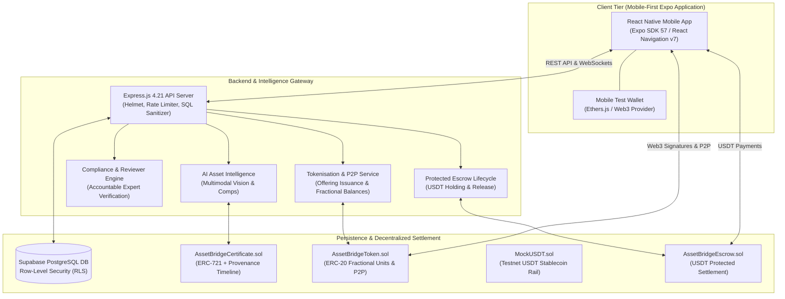

# AssetBridge — Real-World Asset (RWA) Tokenisation & Borderless Settlement Platform

[](https://expo.dev/)
[](https://nodejs.org/)
[](https://supabase.com/)
[](https://sepolia.etherscan.io/)
[](https://tether.to/)
[](LICENSE)

> **"Own More. Trade Smarter. Invest Without Boundaries."**  
> *Verified real-world assets. Digital ownership. Borderless payments.*

AssetBridge is a mobile-first marketplace and investment platform that connects verified physical assets with blockchain-based records, tokenised interests, and stablecoin payments. It helps users discover valuable assets, review evidence about authenticity and condition, and participate in eligible purchases or fractional investment opportunities.

Designed to align directly with:
1. **Real-World Assets Track:** Verified physical asset profiles, provenance records, certificate references, and tokenised portfolio holdings.
2. **Mobile Money & Peer-to-Peer Track:** Mobile-friendly USDT stablecoin payments, payment requests, transaction status, and P2P token transfers.

---

## 🏛️ High-Level System Architecture

AssetBridge combines a mobile-first **React Native (Expo)** client, an **Express.js + Supabase** API and compliance gateway, an **AI Asset Intelligence** engine for indicative valuation and fraud signals, and **Ethereum Sepolia** smart contracts for on-chain certificates, fractional tokenisation, and USDT settlement.



---

## 💎 The Two Marketplace Experiences

AssetBridge supports two connected marketplace experiences:
1. **Physical Asset Marketplace:** Users browse and purchase complete items such as watches, artwork, jewellery, and classic cars. Listings feature professional verification, condition reports, provenance evidence, and an on-chain Certificate of Authenticity.
2. **Tokenised Asset Marketplace:** For eligible assets, an authorised issuer creates digital tokens representing clearly defined contractual, ownership, or economic rights (e.g. 2,000 units each representing 1/2000th undivided economic interest in a $20,000 collectible). Users can buy, hold, or transfer those interests via peer-to-peer rails.

---

## 📦 Core Product Modules

| Module | What It Does | Value |
|---|---|---|
| **1. Verified Asset Registry** | Asset profiles with photos, serial numbers, documents, condition details, and verification status. | Gives each asset a structured digital identity. |
| **2. Expert Verification** | Authorised reviewer checks evidence and records a decision, report, and timestamp. | Accountable human review rather than relying on AI alone. |
| **3. Blockchain Certificate & Provenance** | Anchors a certificate and evidence hash on-chain (`AssetBridgeCertificate.sol`), alongside timeline events. | Makes records easier to check and tampering easier to detect. |
| **4. AI Asset Intelligence** | Indicative valuation ranges, comparable-market insights, and suspicious-listing signals. | Helps users make informed assessments (clearly labeled indicative). |
| **5. Tokenisation** | For eligible offerings, issues ERC-20 tokens (`AssetBridgeToken.sol`) with defined supply and transfer rules. | Enables fractional participation where legally permitted. |
| **6. Stablecoin Payments** | Support for USDT test payments, transaction status, and payment references. | Demonstrates mobile-first digital settlement. |
| **7. Peer-to-Peer Transfers** | Allows users to send eligible tokens to other approved wallets. | Connects RWA ownership with P2P activity. |
| **8. Protected Checkout / Escrow Demo** | Smart-contract workflow holding and conditionally releasing test funds. | Demonstrates transaction safeguards. |
| **9. Personal Asset Portfolio** | Shows physical assets, token balances, payment history, certificates, and estimated values. | One unified place to manage user activity. |
| **10. Admin & Compliance Console** | Review assets, appraisers, token offerings, disputes, and user eligibility. | Operational oversight and accountability. |

---

## 📂 Repository Directory Layout

```
AssetBridge/
├── docs/                      # Centralized Master Documentation Hub
│   ├── README.md              # Documentation index and architecture guides
│   ├── SYSTEM_DIAGRAMS.md     # Production Mermaid diagrams for all subsystems
│   ├── ARCHITECTURE.md        # Comprehensive multi-tier architecture specification
│   ├── FRONTEND_ARCHITECTURE.md # React Native Expo engineering & component guide
│   ├── BACKEND_API.md         # Express REST API endpoints & token workflows
│   ├── BLOCKCHAIN_SMART_CONTRACTS.md # Solidity contracts, ERC-721, ERC-20 & Escrow rules
│   └── DATABASE_SCHEMA.md     # PostgreSQL tables, RLS policies, and migrations
├── Public/App/                # Mobile Frontend (React Native, Expo SDK 57)
│   ├── src/screens/           # 24 production screens (Auth, Market, Invest, Vault, P2P)
│   ├── src/components/        # Theme primitives & UI modals
│   ├── src/constants/         # Obsidian & Royal Light theme tokens, vector icon sets
│   └── App.js                 # Application bootstrap & provider wrapping
├── Backend/                   # Backend Server (Node.js, Express, Supabase)
│   ├── src/services/          # AI Vision, Compliance, Escrow, Web3 Relayer
│   ├── src/routes/            # Auth, Asset, Token, Escrow, Bank, Verification routes
│   ├── src/middlewares/       # Auth (JWT), KYC enforcer, Rate Limiter, SQL guard
│   ├── public/admin/          # Web Admin & Reviewer Operations Portal
│   ├── public/verify/         # Public On-Chain Product Verification Portal
│   └── supabase_setup.sql     # Master database setup & RLS definitions
├── Blockchain/                # Decentralized Settlement (Hardhat, Solidity ^0.8.24)
│   ├── contracts/             # AssetBridgeCertificate.sol, AssetBridgeToken.sol, MockUSDT.sol, AssetBridgeEscrow.sol
│   ├── scripts/               # Automated testnet deployment & verification scripts
│   └── test/                  # Unit and integration test suites
└── Assets/                    # Brand assets, typography, and logos
```

---

## 🚀 Quick Start Guide

### Prerequisites
- **Node.js:** `v18.x` or `v20.x` LTS
- **Package Manager:** `npm` (v9+)
- **Mobile Environment:** Expo Go app installed on your physical device or Android/iOS Simulator

---

### 1. Backend API Server Setup
```bash
# Navigate to Backend
cd Backend

# Start Express server in development mode
npm run dev

# Server launches at http://localhost:5000
# Admin & Reviewer Console available at http://localhost:5000/admin
# Public Verification Portal available at http://localhost:5000/verify
```

---

### 2. Mobile App Setup (React Native Expo)
```bash
# Navigate to Mobile workspace
cd Public/App

# Start Expo dev server
npm start

# Controls:
# - Press 'a' to open Android emulator
# - Press 'i' to open iOS simulator
# - Press 'w' to launch Web interface
# - Scan terminal QR code with Expo Go on a physical phone
```

---

### 3. Blockchain Smart Contracts Setup (Hardhat)
```bash
# Navigate to Blockchain workspace
cd Blockchain

# Run smart contract test suite
npm test
```

---

## 🎯 Suggested 3-Minute Hackathon Demo

| Time | Action | Screen / Flow |
|---|---|---|
| **0:00–0:35** | Show the problem and submit a collectible with photos and evidence. | `HomeScreen` &rarr; `ListAssetScreen` |
| **0:35–1:05** | Switch to the reviewer console, approve the asset and show its certificate/provenance record. | `Admin Console` (/admin) &rarr; `CertificateScreen` |
| **1:05–1:45** | Show the tokenised offering, token supply, and explain exactly what the token represents. | `InvestScreen` (Token Offerings tab) |
| **1:45–2:25** | Complete a test USDT payment and show the transaction confirmation. | `CheckoutScreen` (USDT Settlement) |
| **2:25–3:00** | Transfer a token between users (P2P) and show both updated portfolios. | `VaultScreen` (Portfolio & P2P Transfer) |

---

## 📄 License
MIT License. Built for the Real-World Assets & Mobile Money Hackathon.
